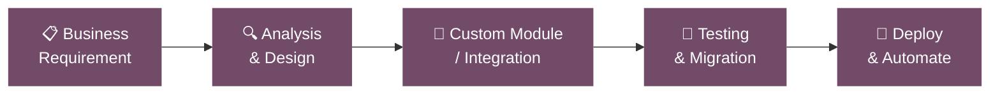

<!-- ===================== HEADER BANNER ===================== -->

 

---

## 👋 About Me

I'm an **Odoo Developer with 5 years of experience** building and customizing ERP solutions that fit how businesses actually work. I turn business requirements into clean, maintainable Odoo modules, connect Odoo with third-party systems, and automate repetitive workflows.

- 🧩 Custom Odoo module development
- 🔄 Odoo version migrations
- 🔌 Third-party API and payment gateway integrations
- ⚙️ Business workflow automation
- 🌱 Currently exploring **AI integration**, **n8n workflow automation** and **advanced Odoo development**
- 🎯 **Goal:** Build scalable ERP solutions and contribute to open source

> 🤝 **Open to** Odoo development opportunities, freelance projects and collaboration. Feel free to reach out!

---

## 🛠️ What I Do

| | Service | Details |
|---|---|---|
| 🧱 | **Custom Development** | New modules, extending standard apps, custom reports and views |
| 🚚 | **Version Migration** | Upgrading Odoo versions with data and customization migration |
| 🔗 | **Integrations** | REST APIs, third-party services, payment gateways |
| 🤖 | **Automation** | Server actions, scheduled jobs, n8n workflows, AI-assisted flows |
| 🎨 | **Frontend (OWL)** | Modern Odoo UI components with OWL, JavaScript, XML, CSS |
| 🐳 | **Deployment** | Docker-based setups on Linux with PostgreSQL |

---

## 📦 Odoo Apps I've Worked With

---

## 💻 Tech Stack

**Core**

**Frontend**

**DevOps and Tools**

**Automation and AI**

---

## 🔄 How I Work

---

## 📊 GitHub Stats

 

 

<!--  -->

---

## 🛒 My Odoo Apps on the Odoo Apps Store

| App | Odoo Version | What it does | Link |
|---|---|---|---|
| **MCP Server** | 19.0 | Connect AI Assistants to Odoo ERP | [Explore](https://apps.odoo.com/apps/modules/19.0/mcp_server_ai) |
| **CPQ eCommerce** | 19.0 | Configure webshop products with dynamic components, real-time pricing, and automatic BOM generation.  | [Explore](YOUR_APP_2_URL) |
| **Multi Product Selector** | 19.0 | Seamlessly select multiple products in a single One2many field. | [Explore](YOUR_APP_3_URL) |

---

## 🌐 Portfolio

---

## 🎯 Currently

- 🔭 Exploring **AI integration** inside Odoo workflows
- ⚙️ Building automations with **n8n**
- 📚 Going deeper into **advanced Odoo development** and **OWL**
- 🌍 Looking to **contribute to open-source** Odoo projects

---

## 📫 Let's Work Together

Need an Odoo developer for customization, migration, integration or automation? Let's talk.

  

<!-- Created with GPRM ( https://gprm.itsvg.in ) and customized -->
